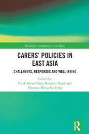

<figure style="margin:2rem 0;text-align:center">
  
  <figcaption>Carers’ Policies in East Asia · Routledge</figcaption>
</figure>

## 关于这本书

Carers’ Policies in East Asia: Challenges, Responses and Well-being 由 Chak Kwan Chan、Kinglun Ngok 与 Florence Meng Soi Fong 主编，Routledge 出版。

本书比较中国、日本、韩国、新加坡、台湾与香港的照护者政策，讨论社会经济变迁下的照护需求，以及政策如何支持家庭照护者、减轻照护负担，改善照护双方的福祉。

## 参与撰写部分

我与 Chak Kwan Chan 共同撰写了第 5 章 **Carers’ Policies in Singapore（新加坡照护者政策）**，收录于本书第 79–94 页。

随着人口老龄化以及残障、慢性病相关照护需求增加，新加坡家庭照护者面临更多压力。本章梳理相关支持措施，包括居家照护津贴、照护课程、培训补助与工作生活支持计划。

章节讨论现有政策的局限：支持仍偏向被照护者，对照护者处境差异的回应有限，也较为依赖家庭承担照护。中老年人、尤其女性承受的责任值得关注。章节据此提出，应加强就业与福利支持，将性别视角纳入政策，帮助照护者兼顾工作与照护。

## 出版信息与链接

- **章节作者**：Ning He & Chak Kwan Chan
- **章节位置**：第 5 章，第 79–94 页
- **出版社**：Routledge
- **丛书**：Routledge Contemporary Asia Series
- **出版年份**：2026（据 Lingnan Scholars 出版记录）
- **章节 DOI**：[10.4324/9781003487517-5](https://doi.org/10.4324/9781003487517-5)

[查看出版社书籍页面 ↗](https://www.routledge.com/Carers-Policies-in-East-Asia-Challenges-Responses-and-Well-being/Chan-Ngok-Fong/p/book/9781003487517)

[查看章节出版页面 ↗](https://doi.org/10.4324/9781003487517-5)

[查看 Lingnan Scholars 章节记录与摘要 ↗](https://scholars.ln.edu.hk/en/publications/carers-policies-in-singapore/)

*本页为书籍及章节介绍。章节简介依据公开摘要整理，全文请通过出版链接查阅。*
